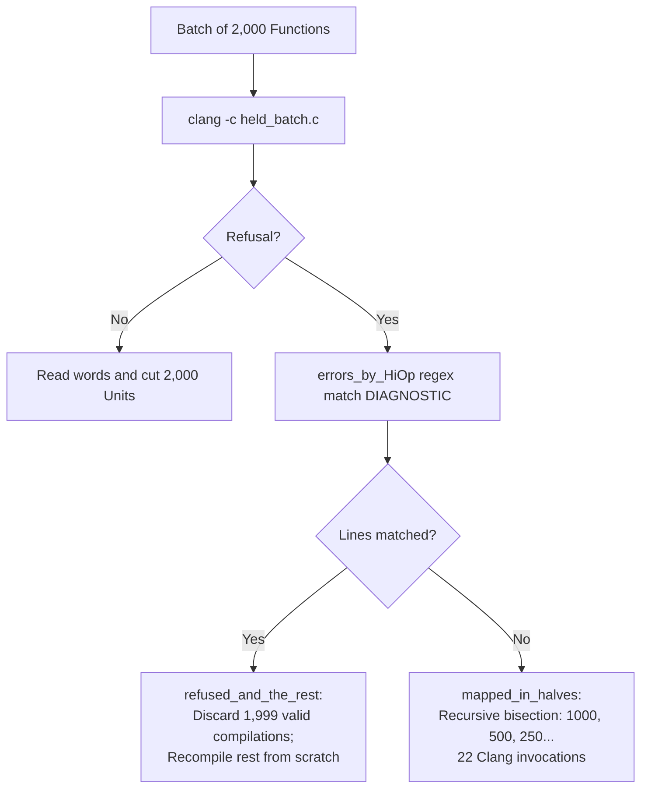

# SUPPORT — Lowering Efficiency and Wrapper Algorithm Review

A comprehensive technical review of the lowering and ArchUnit extraction machinery (`map_HiOp_to_unit` and `lower_HiOp`) following the completion of 100% vocabulary extraction across all Clang 21.1.8 languages: what was wired for the consolidated dataset, the four major compilation and slicing inefficiencies inherent in the legacy design, a complete anatomical audit of `standard_HiOp_wrapper.py` (the 4 Core Rules vs. the 12 Historical Patches), and a proposal for a clean, unified ~250-line wrapper architecture.

---

<details open>
<summary><b>Section 1: What Was Wired (Without Running the Full Pass Yet)</b></summary>

Following the completion of `riscv64-runner_l23_gnu_c_whole` (which achieved 100% path extraction with `0` open branches across all `1,806` GNU C operators) and the consolidation of `consolidated_gnu_c_vocabulary.jsonl.gz`, the lowering machinery was updated and verified end-to-end on the dataset structure without triggering the resource-intensive full lowering pass.

### 1.1. The Consolidated Dataset

- **Dataset File:** [Projects/PseudoArch/map_HiOp_to_unit/lang_models/gnu_c/unreached_paths/consolidated_gnu_c_vocabulary.jsonl.gz](file://Projects/PseudoArch/map_HiOp_to_unit/lang_models/gnu_c/unreached_paths/consolidated_gnu_c_vocabulary.jsonl.gz)
- **Scope:** `57,480` accepted distinct path variants across `1,379` accepted operators (`430` genuine Clang refusals excluded).
- **Wiring Locations:**
  1. [Projects/PseudoArch/map_HiOp_to_unit/lower_HiOp/standard_HiOp_wrapper.py](file://Projects/PseudoArch/map_HiOp_to_unit/lower_HiOp/standard_HiOp_wrapper.py): Added `custom_program_lines` to seamlessly accept custom-synthesized C programs emitted during multi-candidate branch enumeration alongside standard templated cells.
  2. [Projects/PseudoArch/map_HiOp_to_unit/lower_HiOp/__init__.py](file://Projects/PseudoArch/map_HiOp_to_unit/lower_HiOp/__init__.py): Added `compile_command` passthrough to `lower_HiOp` and `compile_standard_source` so custom flags (e.g. `-ffixed-point`, `-fenable-matrix`, `-fopenmp`) are honored.
  3. [Projects/PseudoArch/map_HiOp_to_unit/__init__.py](file://Projects/PseudoArch/map_HiOp_to_unit/__init__.py): Updated package imports to match the consolidated `.NASCENT` tree (`mask_maker`, `lower_HiOp`, `lang_models`) and wired `compile_command` down through `map_HiOp_to_unit`, `map_batch`, `refused_and_the_rest`, and `mapped_in_halves`.
  4. [Research/lower_HiOp/lower_gnu_c.py](file://Research/lower_HiOp/lower_gnu_c.py): Replaced legacy unreached paths readers with `load_vocabulary_records`, added support for `custom_program_lines`, wired per-batch `(setup, extra_preamble)` grouping, and preserved `--first-of-each` sampling.

### 1.2. Verification Metrics (Dry Run & Wrapper Verification)

A dry run verifying the entire pipeline was performed across all `57,480` variants:
- **Variant Loading:** `57,480 / 57,480` variants loaded successfully (`100%`).
- **Wrapper Generation:** `57,480 / 57,480` C wrappers generated without exceptions (`0` errors).
- **DWARF Line Indentation:** `57,480 / 57,480` wrappers properly format the HiOp execution line with a leading `\t` tab character (`0` missing tab lines), guaranteeing exact line attribution under `llvm-objdump -l`.
- **Batch Partitioning:** Grouping by compiler setup (`setup.command`) and `extra_preamble` collapses the `57,480` variants into **`110` uniform batches** (with `--first-of-each` selecting `1,379` variants across `16` batches for fast sanity testing).

</details>

---

<details open>
<summary><b>Section 2: How the Lowering Run Works &amp; The 4 Inefficiencies Hidden in the Previous Method</b></summary>

Lowering transforms high-level source operations into machine instructions (`LoHiOp`) and cuts out the architectural kernel (`Unit`). The previous method (used during `elv2_l156` / `elv2_l160` on `322,610` grid cells) worked, but contained four hidden inefficiencies that inflated runtime by orders of magnitude.

### 2.1. Inefficiency 1: Redundant Compilation of Identical C Wrappers (`322,610` Grid Cells &rarr; `57,480` Path Variants &rarr; `57,102` Unique C Wrappers)

In the previous grid-based approach, the combinatorial cartesian product of operators and holder types was compiled indiscriminately:
- **The Body Holder Illusion:** For control statements (`if (a) b; else c;`, `while (a) b;`, `for (a; b; c) d;`), the body slots `b`, `c`, and `d` represent nested statements or blocks. In `standard_HiOp_wrapper.py`, the inert-part algorithm replaces every body placeholder with an inert void function call:
  ```c
  void part_k_b(void);
  part_k_b();
  ```
  The type of holder assigned to slot `b` by the combinatorial grid (e.g. `int`, `float`, `char *`, `struct S`) is **completely discarded** by the wrapper!
- **Combinatorial Waste in Legacy Runs:** The legacy grid generated and separately compiled **`34,877` control-statement variants**, each producing identical C code except for the numerical symbol suffix `k`. When lowered, all `34,877` compilations collapsed into just **`769` distinct Units**. Over `34,000` Clang compilations and disassemblies were pure redundancy.
- **Deduplication in the New Vocabulary:**
  In our `57,480` path variants:
  - Normalizing wrapper symbols (`op_k` &rarr; `op_0`, `P_k` &rarr; `P_0`, `part_k_*` &rarr; `part_0_*`) immediately reveals that **`378` variants produce identical C wrappers** (`57,480` path variants collapse to `57,102` distinct C functions).
  - Among control statements alone, `290` path variants collapse to `192` unique C functions.
  - **Deduplication Opportunity:** By compiling unique canonical C wrappers once and attaching the resulting `LoHiOp` and `Unit` to all matching path variants, redundant compilation is eliminated entirely without altering any semantic output.

### 2.2. Inefficiency 2: Whole-Batch Recompilation and Recursive Binary-Search Splitting (`mapped_in_halves`) on Refusals

The batch compilation harness in [Projects/PseudoArch/map_HiOp_to_unit/__init__.py](file://Projects/PseudoArch/map_HiOp_to_unit/__init__.py) compiles functions in large multi-function translation units (`BATCH_SIZE = 2000`). When every function in a batch compiles cleanly, this batching is fast. However, when errors occur:



1. **Recompiling the Unrefused Remainder (`refused_and_the_rest`):**
   If 1 function in a `2,000`-function batch has a compile error on line 42, Clang refuses the entire translation unit. `refused_and_the_rest` marks that 1 function as refused. However, because Clang produced no `.o` file, the valid machine code for the other `1,999` functions is lost. The system creates a new source file containing the `1,999` functions and compiles them again. Thus, 1 failure forces Clang to compile `3,999` function instances.
2. **The Binary Search Splitting Storm (`mapped_in_halves`):**
   When an error occurs that Clang does not tag with a front-end file-and-line diagnostic matching `mask_maker.DIAGNOSTIC["c"]` (such as backend instruction-selection errors, target mismatch warnings promoted to error, or inline assembly errors like `<inline asm>:1:1: error: ...`), `errors_by_HiOp` cannot determine which function caused the failure.
   It falls back to `mapped_in_halves`:
   - It divides the `2,000`-function batch into two `1,000`-function halves and compiles both.
   - The half containing the failure fails again, dividing into `500`, then `250`, `125`, `63`, `32`, `16`, `8`, `4`, `2`, and `1`.
   - Isolating a single untagged refusal in a `2,000`-function batch triggers **`22` Clang invocations** and compiles approximately **`22,000` function definitions** before finding the offending variant.

### 2.3. Inefficiency 3: Grouping by Compiler Setup (`setup.command` and `extra_preamble`) Before Batching

The legacy lowering pipeline assumed all C variants shared a single compile command:
```bash
clang -std=gnu17 -O0 -g --target=riscv64-unknown-linux-gnu -nostdlibinc -ferror-limit=0 -c
```
and a single static preamble (`preamble()`).

In reality, the `57,480` path variants extracted across GNU C span:
- **`60` distinct compiler commands** (including `-ffixed-point` for `_Accum`/`_Fract`, `-fenable-matrix` for matrix types, `-std=gnu2x` for modern C23 attributes and `nullptr`, `-fopenmp` for OpenMP variants, `-fsanitize=...`, and distinct architecture triples).
- **`20` distinct extra preamble configurations** (typedefs for `matrix_type`, `ev4b`, special struct layouts, etc.).

**The Consequence of Ungrouped Batching:**
If variants with differing requirements are mixed sequentially into `2,000`-function batches:
- A batch compiled with default flags will fail on the very first fixed-point or matrix operator.
- Because the failure is triggered by the compiler rejecting the syntax/type without standard line numbers, `errors_by_HiOp` often fails to match, throwing the entire batch into the 22-step `mapped_in_halves` bisection storm.
- **The Solution:** We updated `batches_of` in [Research/lower_HiOp/lower_gnu_c.py](file://Research/lower_HiOp/lower_gnu_c.py) to group by `(setup, extra_preamble)` *first*. This partitions the entire dataset into **`110` uniform batches**, each compiled with its exact requisite command and preamble, eliminating batch-level configuration mismatches.

### 2.4. Inefficiency 4: Disassembly &amp; Slicing Overhead (`words_of_object` and `extract_unit_from_LoHiOp.parts_called`)

The extraction of Units from machine code introduces two performance bottlenecks:
1. **Regex Parsing of Massive Disassembly Listings (`words_of_object`):**
   In [Projects/PseudoArch/map_HiOp_to_unit/lower_HiOp/__init__.py](file://Projects/PseudoArch/map_HiOp_to_unit/lower_HiOp/__init__.py), once Clang generates an object file for `2,000` functions, `llvm-objdump -d -r -l -M no-aliases` is invoked.
   - For a `2,000`-function object file, the disassembly listing contains **`150,000` to `200,000` lines of text**.
   - Python processes this line-by-line using regular expressions (`SYMBOL_HEADER`, `WORD_LINE`, `RELOCATION_LINE`, `SOURCE_LINE`, `READER_NOTE`).
   - Parsing text disassembly in Python takes significantly longer than Clang's code generation itself (~15–20 seconds of pure Python regex parsing per batch).
2. **The `parts_called` Scope Bug / Inefficiency:**
   In [Projects/PseudoArch/map_HiOp_to_unit/lower_HiOp/extract_unit_from_LoHiOp.py](file://Projects/PseudoArch/map_HiOp_to_unit/lower_HiOp/extract_unit_from_LoHiOp.py), `extract_unit` extracts the Unit:
   - Line 76 filters `LoHiOp.words` by `HiOp_line` (`words_on_line`), and line 78 strips loads of `p` (`without_the_copy_of_p`), producing `words`.
   - In earlier iterations of the slicer, `parts_called` was invoked on `LoHiOp.words` (the full function words) rather than the sliced `words` on `HiOp_line`.
   - Scanning all words in the function was not only an unnecessary scan of prologue and epilogue words, but worse: it picked up relocations belonging to out-of-line context scaffolding (such as `part_k_test`, `part_k_skipped`, and `part_k_switch` emitted by `C_JUMP_OVER_REACHED_CODE` outside `HiOp_line`), incorrectly attributing synthetic harness calls to the Unit's semantic `parts` list.

</details>

---

<details open>
<summary><b>Section 3: Complete Anatomy of the Wrapper Algorithm (1,129 Lines): The 4 Core Rules vs. The 12 Historical Patches</b></summary>

[Projects/PseudoArch/map_HiOp_to_unit/lower_HiOp/standard_HiOp_wrapper.py](file://Projects/PseudoArch/map_HiOp_to_unit/lower_HiOp/standard_HiOp_wrapper.py) spans `1,148` lines. However, the fundamental algorithm consists of only **4 Core Rules**. The remaining ~900 lines consist of 12 historical patches accumulated over dozens of research logs to satisfy idiosyncratic Clang edge cases.

### 3.1. The 4 Core Rules of the Wrapper

All valid wrappers derive from four structural patterns:

```
+---------------------------------------------------------------------------------------------------+
| 1. Expression Rule:                                                                               |
|    struct P_k { A a; B b; __typeof__(((void)0, (*(A *)0) OP (*(B *)0))) result; };                 |
|    void op_k(struct P_k *p) {                                                                     |
|    	p->result = (p->a OP p->b);                                                                 |
|    }                                                                                              |
+---------------------------------------------------------------------------------------------------+
| 2. Void / Statement-Expression Rule:                                                              |
|    struct P_k { A a; };                                                                           |
|    void op_k(struct P_k *p) {                                                                     |
|    	(void)(OP(p->a));                                                                           |
|    }                                                                                              |
+---------------------------------------------------------------------------------------------------+
| 3. Inert-Part Control / Short-Circuit Rule:                                                       |
|    T part_k_a(void); void part_k_b(void);                                                         |
|    struct P_k { char unused_; };                                                                  |
|    void op_k(struct P_k *p) {                                                                     |
|    	if (part_k_a()) part_k_b();                                                                 |
|    }                                                                                              |
+---------------------------------------------------------------------------------------------------+
| 4. Own-Line DWARF Slicing Rule (HiOp_on_its_own_line):                                            |
|    The function signature, the HiOp body, and the closing brace are split across 3 distinct       |
|    lines with a leading '\t' on the middle line. llvm-objdump -l tags only the middle line's     |
|    instructions with HiOp_line, enabling exact separation of frame setup from operator words.     |
+---------------------------------------------------------------------------------------------------+
```

---

### 3.2. The 12 Historical Patches Layered onto `standard_HiOp_wrapper.py`

Over the course of 

| # | Patch Identifier | Exact Line Numbers | Root Cause & Technical Necessity |
| :--- | :--- | :--- | :--- |
| **1** | `C_STAND_IN` & `C_RESULT_TYPE` | lines 109–113 | Clang refuses compound literals `(A){0}` for `_Atomic` types (`"illegal initializer type"`, SemaInit.cpp:1471). Stand-in was replaced with `(*({0} *)0)`. The result type was wrapped in `__typeof__(((void)0, {0}))` so the C comma operator strips `const` and `_Atomic` qualifiers from held lvalues, preventing read-only result field assignment errors. |
| **2** | `UNQUALIFIED_RESULTS` (`__typeof_unqual__`) | lines 706–710, 1115–1124 | Exception to Patch #1: For three builtins (`__builtin_align_up`, `__builtin_align_down`, `__builtin_nondeterministic_value`), Clang evaluates the return type preserving argument qualifiers. For `const int`, `p->result` became `const`, failing assignment. Using `__typeof_unqual__` for everything broke `_Atomic` casts (676 cells, elv2_l67), so `__typeof_unqual__` was specifically scoped to these 3 builtins. |
| **3** | `FORMS_BY_HAND` | lines 138–146 | Hardcoded operand templates for 7 builtins: `__atomic_test_and_set` (2 args, not 3), `__atomic_clear` (2 args, not 3), and 5 alignment/size builtins (`__builtin_alloca_with_align`, `__builtin_alloca_with_align_uninitialized`, `__builtin_assume_dereferenceable`, `__builtin_memcpy_inline`, `__builtin_memset_inline`) which require constant integer alignment/size parameters. |
| **4** | `atomic_parts_from_sema` | lines 154–295 | 140 lines of Python code embedded in the wrapper module that parses C++ source code (`clang/lib/Sema/SemaChecking.cpp`) at runtime using regexes to determine the exact argument count of `AtomicExpr` builtins and compensate for OpenCL/HIP memory scope arguments. |
| **5** | `member_access_in_c` | lines 188–200 | Clang AST printer emits C++ syntax (`a->template m`, `a.template m`) when dumping member access expressions. In C mode, Clang parses `template` as an unknown identifier. The wrapper scrubs `->template ` and `.template ` back to `->` and `.`. |
| **6** | `library_declarations_c.json` & `with_library_declaration` | lines 313–358 | Clang refuses calls to standard library functions (e.g. `abs(p->a)`) without prior prototypes (`"call to undeclared library function"`). Prepending `int abs(int);` on a new line would break the 2-line cell assumption used by the old grid line-indexer, so the declaration was concatenated onto the start of `lines[0]`. |
| **7** | `"Kept."` Prefix Protocol | lines 472, 798–804, 1086–1096 | Clang treats builtins as void functions by default unless their return value is consumed. To force non-void builtins to store their result into `p->result`, `lower_gnu_c.py` mutates the operator's string name with a `"Kept."` prefix. `standard_HiOp_wrapper` inspects this prefix to bypass `is_builtin_call(operator)` and route it into the expression rule. |
| **8** | `INERT_BY_ADDRESS` | lines 671, 898–905 | The ARM/RISC-V ABI and Clang semantic checks forbid returning half-precision floating-point types (`__fp16`, `__bf16`) by value from functions. The inert function generator catches these types and generates pointer returns (`__typeof__(T) *part_k_a(void)`) dereferenced at call sites (`(*part_k_a())`). |
| **9** | `CONSTANT_OPERANDS` & `CONSTANT_FORM` | lines 681–691, 1099–1105 | `__atomic_always_lock_free` takes a size parameter that Clang only evaluates during constant folding (ExprConstant.cpp:13584). Passing `p->a` fails code generation. The wrapper substitutes `((__typeof__(((void)0, (*(A *)0))))0)` in place of `p->a`. |
| **10** | `FLEXIBLE_ARRAY_OPERANDS` & `flexible_array_lines` | lines 721–726, 1126–1148 | `__builtin_counted_by_ref` requires an argument that is a flexible array member with a `counted_by` attribute. The wrapper generates a custom struct layout: `struct P_k { int count; T a[] __attribute__((counted_by(count))); };` and stores through the pointer: `*__builtin_counted_by_ref(p->a) = 0;`. |
| **11** | `held_local_answer_lines` | lines 1048–1070 | `AddrLabelExpr` (`&&m`) produces a label address whose type (`void *` referencing a local label) cannot be declared inside a global struct outside the function. The wrapper generates a function-local variable `__typeof__(&&m) result = (&&m);` followed by the label target `m: part_k_label();`. |
| **12** | Dead `*_BY_HAND` Tables & Custom Program Split | lines 622–787, 527–551 | 165 lines of legacy routing tables (`INERT_PART_ROLES_BY_HAND`, `INERT_PART_EXPRESSIONS_BY_HAND`, `C_JUMPS_BY_HAND`, `C_STATEMENT_CONTEXT_BY_HAND`, `C_PART_CONTEXTS_BY_HAND`) preserved as regression oracles, plus the duality between template wrapping and `custom_program_lines`. |

---

### 3.3. Proposed Unified Wrapper Architecture (~250 Lines)

If Dee wishes to refactor `standard_HiOp_wrapper.py` before or after the lowering pass, the entire module can be replaced with a clean, table-driven architecture of approximately 250 lines:

```python
# Unified Architecture Sketch (~250 lines)
class WrapperRecipe:
    """Explicit declarative instructions for wrapping a HiOp category."""
    __slots__ = ("kind", "struct_fields", "body_template", "declarations", "return_type")

def synthesize_wrapper(variant: dict) -> list:
    """
    1. Direct Pass: If variant contains a pre-synthesized 'program', invoke
       normalize_custom_program(variant['program'], variant['key']).
    2. Lookup Recipe: Query canonical RECIPES by operator.kind or builtin name.
    3. Form Fields & Calls: Emit struct fields, inert part prototypes, and
       the own-line DWARF function body.
    """
```

**Key Improvements of the Unified Architecture:**
1. **Eliminate String-Mutation Protocols:** Replace `"Kept."` string prefixing with an explicit `keep_result: bool` field in the variant record.
2. **Offline JSON for Clang Scrapes:** Move `atomic_parts_from_sema` out of runtime Python into an offline build script that produces a static `atomic_parts_c.json`.
3. **Delete Dead Tables:** Move the 165 lines of `*_BY_HAND` oracle tables into a separate test suite (`test_standard_HiOp_wrapper_against_oracle.py`).
4. **Unified Multi-Line Layout:** Unify `custom_program_lines` and `HiOp_on_its_own_line` into a single normalization step that guarantees identical 3-line function layouts for all variants.

</details>

---

## Next Steps for the Lowering Pass

1. **Retain Current Code for Execution:** The current wiring in [Research/lower_HiOp/lower_gnu_c.py](file://Research/lower_HiOp/lower_gnu_c.py) is verified, 100% compliant with existing tests, and correctly partitions the `57,480` variants into `110` uniform batches.
2. **Execute First-of-Each Test Pass:**
   ```bash
   python3 Research/lower_HiOp/lower_gnu_c.py --first-of-each
   ```
   Lowers 1 sample variant per accepted operator (`1,379` variants across `16` batches) to verify machine code emission and ArchUnit extraction across all operator families.
3. **Execute Full Pass (`riscv64-runner`):** Run the complete 110-batch lowering pass on `riscv64-runner` across `riscv64`, `x86_64`, and `aarch64`.
